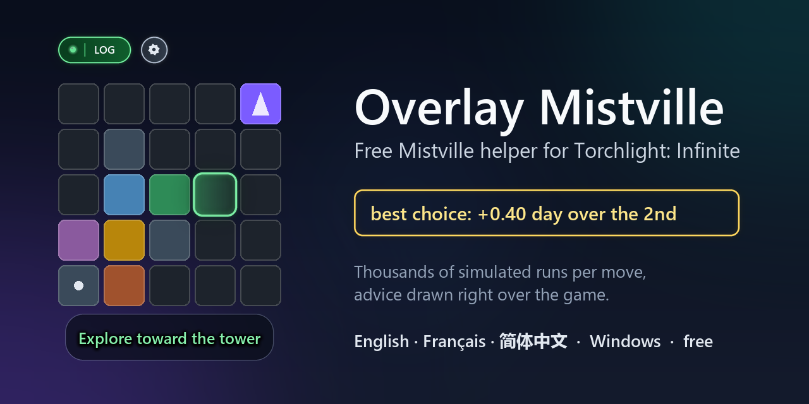

# Overlay Mistville: the Mistville helper for Torchlight: Infinite

Free, unofficial overlay for the **Mistville** mode of *Torchlight: Infinite*. During a run it simulates your options with
Monte-Carlo and draws the suggested move over the game. English by default, French and Simplified Chinese available in the tray menu.

[Français plus bas](#français) · [简体中文](#简体中文)

## Download

Get `Overlay Mistville.exe` from the [Releases](../../releases) page. This repository only hosts releases and this page:
the source code is private.

The file is not digitally signed, so Windows SmartScreen or an antivirus may warn you. Only download it from this page and
compare its SHA-256 hash with the one published in the release.

## Requirements

- Windows 10 or 11, 64-bit
- *Torchlight: Infinite* on Steam, in English, windowed or borderless
- Windows English language pack with optical character recognition
- **In the game's settings, turn on Enable Log.** Without it the game does not write the run to its log and the overlay sees
  nothing. The game turns it off every time it starts: the **LOG** light at the top of the overlay is green when it is on,
  red when it is off.

## What it does, and what it does not do

It reads the game's log file and the part of the screen used by the game, then draws on top of it. It does **not** read or
change the game's memory, does not change game files, and does not press keys or click for you.

> **Warning.** This tool is unofficial and is not affiliated with XD or the makers of *Torchlight: Infinite*. The game's
> publisher forbids some third-party tools and has banned accounts. Nothing guarantees this overlay is tolerated. **Use it
> at your own risk.**

## It gets better every day

Every night the overlay's advice is recalculated from the runs players choose to share, then published here. The overlay
downloads the new data on its own (data only, never code). You can turn this off in the tray menu.

## Good at Mistville?

**Make your own choices instead of following the overlay, and turn sharing on.** Your decisions are what teach it new
strategies to reach day 15.

## Testers wanted

The overlay is young and has only been tried on a few PCs. Especially useful: other screen resolutions (1440p, 4K,
ultrawide), windowed or borderless, laptops and PCs with few cores, Windows in another language (with the English language
pack added). Tell us what works and what does not with a [test report](../../issues/new?template=test_report.yml) (two
minutes), or ask your questions in [Discussions](../../discussions). Never paste the game's log file: it contains your
account details. If the overlay helps you, a star (⭐ at the top of this page) helps other players find it.

## Sharing your runs (optional, off by default)

You can choose to share your Mistville runs to improve the simulations. Nothing is sent unless you tick the box in *Data
sharing*, and the overlay works exactly the same without it. The window shows an exact example of what would be sent, and
you can stop and delete your contributions at any time. See [privacy](CONFIDENTIALITE.txt).

Never sent: the game's log file, your name, account, SteamID, email, files, screenshots, play times, or PC information.

## FAQ

**The overlay shows nothing, or stays on "Waiting for a run".** Turn on *Enable Log* in the game's settings: the game turns it
off every time it starts, and without it the overlay cannot follow your run. The **LOG** light at the top of the overlay must be
green. The game must also be in English, windowed or borderless.

**Can I get banned?** The overlay only reads the game's log file and the screen, then draws on top. It does not read or change
the game's memory, does not touch game files and does not press keys for you. But the publisher forbids some third-party tools
and has banned accounts: nothing guarantees this overlay is tolerated. Use it at your own risk.

**Does it play for me?** No. It suggests a move and shows how many days each choice gains or loses; you decide and play.

**Does it work with the game in Chinese or another language?** Not yet: it reads the English text on screen. The overlay itself
is available in English, French and Simplified Chinese.

**Is it free? Where is the source code?** It is free. The source code is private: this page only hosts the releases, each with
its SHA-256 hash.

**Windows SmartScreen or my antivirus warns me.** The file is not digitally signed yet. Only download it from this page and
compare its SHA-256 hash; if your antivirus dislikes the .exe, use the .zip.

## Licence

Free to use. No selling, no redistribution outside this page, no republishing under another name. See [licence](LICENCE.txt).

---

## Français

Overlay gratuit et non officiel pour le mode **Mistville** de *Torchlight: Infinite*. Pendant la partie, il simule vos options
et dessine le coup conseillé sur le jeu.

**Téléchargement :** `Overlay Mistville.exe` sur la page [Releases](../../releases). Ce dépôt ne contient que les versions
publiées et cette page : le code source est privé. Le fichier n'est pas signé : Windows peut afficher un avertissement.
Téléchargez-le uniquement ici et comparez son empreinte SHA-256 à celle publiée avec la version.

**Configuration :** Windows 10 ou 11 en 64 bits, *Torchlight: Infinite* sur Steam, en anglais, en fenêtre ou plein écran
fenêtré, pack de langue anglaise de Windows avec la reconnaissance de texte. **Dans les paramètres du jeu, activez « Enable
Log »** : sans elle, le jeu n'écrit pas la partie dans son journal et l'overlay ne voit rien. Le jeu la coupe à chaque
lancement : le voyant **LOG** en haut de l'overlay est vert quand elle est active, rouge sinon.

**Ce qu'il fait :** il lit le fichier journal du jeu et la partie de l'écran occupée par le jeu, puis dessine par-dessus. Il
ne lit ni ne modifie la mémoire du jeu, ne touche à aucun fichier du jeu, n'appuie sur aucune touche à votre place.

> **Attention.** Outil non officiel, sans lien avec XD ni les créateurs de *Torchlight: Infinite*. L'éditeur du jeu interdit
> certains outils tiers et a sanctionné des comptes. Rien ne garantit que cet overlay soit toléré. **Vous l'utilisez à vos
> risques.**

**Vous êtes bon à Mistville ?** Faites vos propres choix plutôt que de suivre l'overlay, et activez le partage : vos
décisions lui apprennent de nouvelles stratégies pour atteindre le jour 15.

**Testeurs recherchés :** l'overlay est jeune et n'a été essayé que sur quelques PC. Surtout utile : d'autres résolutions
(1440p, 4K, ultra-large), en fenêtre ou plein écran fenêtré, les portables et les PC avec peu de cœurs, Windows dans une autre
langue (avec le pack anglais ajouté). Dites ce qui marche ou non avec un [rapport de test](../../issues/new?template=test_report.yml)
(deux minutes), ou posez vos questions dans [Discussions](../../discussions). Ne collez jamais le fichier journal du jeu : il
contient les informations de votre compte. Si l'overlay vous aide, une étoile (⭐ en haut de cette page) aide d'autres joueurs à
le trouver.

**Il s'améliore chaque jour :** ses conseils sont recalculés chaque nuit à partir des parties partagées, puis téléchargés tout
seuls (des données, jamais de code). Désactivable dans le menu de l'icône. L'overlay est en anglais, le français et le chinois simplifié se
choisissent dans le menu.

**Partage des parties (facultatif, désactivé par défaut) :** rien n'est envoyé sans votre accord, l'overlay marche pareil
sans partage, et vous pouvez tout arrêter et effacer à tout moment. Voir [confidentialité](CONFIDENTIALITE.txt).

**Questions fréquentes**

- **L'overlay n'affiche rien, ou reste sur « En attente d'une partie ».** Activez « Enable Log » dans les paramètres du jeu : le
  jeu la coupe à chaque lancement. Le voyant **LOG** doit être vert, et le jeu en anglais, en fenêtre ou plein écran fenêtré.
- **Puis-je être banni ?** L'overlay ne lit que le fichier journal du jeu et l'écran, puis dessine par-dessus : il ne lit pas la
  mémoire du jeu, ne modifie aucun fichier du jeu et n'appuie sur aucune touche à votre place. Mais l'éditeur interdit certains
  outils tiers et a sanctionné des comptes : rien ne garantit qu'il soit toléré. Vous l'utilisez à vos risques.
- **Joue-t-il à ma place ?** Non : il conseille un coup et montre combien de jours chaque choix fait gagner ou perdre ; vous
  décidez.
- **Marche-t-il avec le jeu en chinois ou dans une autre langue ?** Pas encore : il lit le texte anglais à l'écran. L'overlay
  lui-même est en anglais, en français ou en chinois simplifié.
- **Est-il gratuit ?** Oui. Le code source est privé : cette page ne contient que les versions publiées, chacune avec son
  empreinte SHA-256.

**Licence :** usage gratuit. Pas de vente, pas de redistribution hors de cette page, pas de republication sous un autre nom.
Voir [licence](LICENCE.txt).

## 简体中文

免费的非官方 *Torchlight: Infinite*（火炬之光：无限）**Mistville** 模式覆盖层。对局中用蒙特卡洛模拟你的选项，并在游戏上方显示建议。默认语言为英文，可在托盘图标菜单中选择简体中文。

**游戏语言必须设置为英文**：覆盖层通过屏幕文字识别读取英文物品名称，切换覆盖层语言不会改变这一点。物品名称保持英文。

- 需要 Windows 10 或 11（64 位）、Steam 版游戏（窗口或无边框模式）以及 Windows 英文语言包。
- **在游戏设置中开启「Enable Log」**：否则游戏不会把对局写入日志，覆盖层什么也看不到。游戏每次启动都会关闭它：覆盖层顶部的 **LOG**
  指示灯开启时为绿色，关闭时为红色。
- 从 [Releases](../../releases) 页面下载 `Overlay Mistville.exe`。文件没有数字签名，Windows SmartScreen 或杀毒软件可能会发出警告。
- **风险：** 这是非官方工具，与 XD 及游戏开发者无关。发行商禁止某些第三方工具，并已封禁过账号。使用风险由你自行承担。
- 数据共享是可选的，默认关闭。详见 `CONFIDENTIALITE.txt`。
- **招募测试者**：覆盖层还很新，只在少数电脑上试过。特别需要：其他屏幕分辨率（1440p、4K、超宽屏）、窗口或无边框模式、笔记本和核心较少的电脑，
  以及其他语言的 Windows（需添加英文语言包）。请通过[测试报告](../../issues/new?template=test_report.yml)告诉我们哪些可用、哪些不可用，
  或在 [Discussions](../../discussions) 提问。请勿粘贴游戏日志文件：其中包含你的账号信息。如果覆盖层对你有帮助，点个星标（页面顶部的 ⭐）
  能让更多玩家找到它。

**常见问题**

- **覆盖层什么也不显示，或一直显示「等待对局」**：请在游戏设置中开启「Enable Log」，游戏每次启动都会关闭它。覆盖层顶部的 **LOG**
  指示灯必须为绿色；游戏需为英文，并使用窗口或无边框模式。
- **会被封号吗？** 覆盖层只读取游戏日志文件和屏幕，然后在上方显示：不读取游戏内存，不修改任何游戏文件，也不会替你按键。但发行商禁止
  某些第三方工具，并已封禁过账号，无法保证本工具会被容忍。使用风险由你自行承担。
- **它会替我玩吗？** 不会。它只建议下一步，并显示每个选择能多坚持或少坚持几天，由你决定。
- **游戏是中文或其他语言时能用吗？** 暂时不能：它读取屏幕上的英文文字。覆盖层本身提供英文、法文和简体中文界面。
- **免费吗？** 免费。源代码不公开：本页面只发布版本文件，每个版本都附有 SHA-256 校验值。
